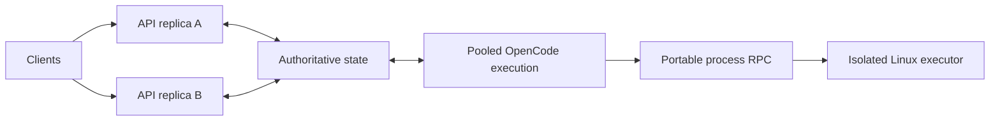

# opencode-cluster — alpha

A vendor-neutral cluster extension to OpenCode **v2.0.32**. Sessions share an
OpenCode runtime instead of requiring one OpenCode process per agent.

**This is an experimental implementation, not a demonstrated fleet of 1,000
simultaneously active coding agents.** The PostgreSQL backend prioritizes correct
shared state and a small upstream patch over throughput.

## What works

- Multiple native HTTP API replicas read and write the same authoritative state.
  Clients use the existing OpenCode session API and client library.
- A separate worker executes multiple sessions within one process. An acknowledged
  prompt remains in durable storage if its API replica stops.
- Renewable PostgreSQL leases with monotonically increasing epochs reject writes
  from an expired worker. The database clock determines expiry.
- A durable event outbox relays committed events to other replicas, including
  session-log subscribers. Reconnect using the native durable log cursor.
- A Cloudflare Worker runs the same OpenCode server on Durable Object SQLite.
  Cloudflare Containers or an external HTTP executor provide Linux tools.
- The portable process transport streams stdin, stdout, stderr and exit codes.
  It supports remote files and shell/Git commands.
- A checksummed logical database archive moves the upstream schema and session
  history between native SQLite and Durable Objects. Credential tables retain
  their schema but export no values.

The API can reach the authoritative database from any replica. Execution still
has an owner: concurrent writers to one session must be coordinated. On Cloudflare,
the Durable Object supplies that authority; on native hosts, PostgreSQL supplies it.



## Deployment profiles

| Profile              | State and coordination                 | Tool execution                                     | Verification                                                                                                                                   |
| -------------------- | -------------------------------------- | -------------------------------------------------- | ---------------------------------------------------------------------------------------------------------------------------------------------- |
| Docker / self-hosted | PostgreSQL + SQLite checkpoint adapter | Separate Linux container and volume                | Real PostgreSQL, process transport, binary files and Git tested locally                                                                        |
| Google Cloud Run     | Same native API image + PostgreSQL     | Separately supervised worker and isolated executor | API manifest supplied; no live GCP deployment                                                                                                  |
| Cloudflare Workers   | Durable Object SQLite + alarms         | Cloudflare Container, or `EXECUTION_URL`           | Local workerd session API, restart, archive round trip and agent execution with a synthetic HTTP model tested; managed containers not deployed |
| Celld                | Potential workerd-compatible adapter   | Celld-managed containers                           | Not qualified or integrated                                                                                                                    |

The provider-independent interfaces live in `packages/cluster/src/contracts.ts`.
The common RPC does not depend on a cloud SDK. `src/objects.ts` provides R2 and
signed-HTTP object adapters, but automated object-store backups are not yet wired.
Cloudflare is optional; the native deployment does not depend on Cloudflare.
The Cloudflare deployment does not require a Google service.

## Try the native deployment

Use Docker Engine, or OrbStack on macOS. From the repository root:

```sh
cp packages/cluster/deploy/.env.example packages/cluster/deploy/.env
# Fill all three passwords with independent random hex strings, e.g. openssl rand -hex 32.
docker compose --env-file packages/cluster/deploy/.env \
  -f packages/cluster/deploy/compose.yaml up --build -d --scale api=2
docker compose --env-file packages/cluster/deploy/.env \
  -f packages/cluster/deploy/compose.yaml port --index 1 api 8080
docker compose --env-file packages/cluster/deploy/.env \
  -f packages/cluster/deploy/compose.yaml port --index 2 api 8080
```

Both API ports accept Basic authentication with username `opencode` and the
configured `CLUSTER_PASSWORD`. Create a session through one port, then read its ID
through the other. Put a TLS reverse proxy in front of the API for remote clients.
The executor has no published host port in Compose.

Set `OPENCODE_CONFIG_CONTENT` identically on API and worker containers to configure
models, including an OpenAI-compatible provider such as Mercury. Supply credentials
through your deployment's secret mechanism. This fork does not change the model
provider or bypass its quotas. Mercury and Paseo integration have not been tested.
Paseo must connect to the shared server rather than continue spawning a new local
OpenCode binary per agent.

Use `/workspace` for session locations. The persistent volume belongs to one
trusted installation. Use separate namespaces **and separate executor volumes**
for independent installations.

Stop services without removing their volumes:

```sh
docker compose --env-file packages/cluster/deploy/.env \
  -f packages/cluster/deploy/compose.yaml down
```

See [Cloud Run deployment](packages/cluster/deploy/gcp/README.md) and
[Cloudflare deployment](packages/cluster/deploy/cloudflare/README.md) for provider
configuration and the checks still required before deploying.

## Current limits

- **PostgreSQL stores one complete SQLite image per namespace.** Each SQL scope
  locks that row and reads its current image. Writes replace the image. This is
  a correctness-first alpha adapter, with serialized access and growing bandwidth
  costs. It needs a row-level backend or independently coordinated shards before
  claiming high throughput for thousands of busy sessions.
- One native execution owner serves each namespace. `CLUSTER_CONCURRENCY`
  (default 8) limits external admission; nested native subagents can exceed it.
  Automatic fleet scheduling and session-family sharding are not implemented.
- Worker takeover marks uncertain, previously running sessions interrupted. It
  does not blindly replay an external tool. Fencing database writes cannot undo
  an already-sent command or guarantee exactly-once side effects.
- Durable events are shared. Ephemeral token deltas are not relayed between
  native replicas. The outbox currently has no retention job.
- PTYs, persistent terminal sessions, worktree/VCS UI endpoints, browser pairing
  and mutable configuration endpoints return `501`. Shell tools can use Git;
  interactive terminal parity is unfinished. Config comes from the deployment.
- Filesystem discovery/watchers, native plugins, image transforms and shell
  parsing have additional limitations in the upstream workerd profile. The
  remote file implementation is intended for small files and bounded workloads.
- RPC process identities are in memory. Lost executor state produces an explicit
  uncertain-outcome error. Completed commands are retained briefly for idempotent
  spawn acknowledgement, not durable replay. Custom file descriptors and some
  nested pipelines are unsupported.
- Database archives do not include workspace files, external objects or in-flight
  processes. Back up workspace volumes separately while all writers are stopped.
  Cloudflare filesystem snapshots are provider-specific, not portable archives.
- A namespace is a trusted installation, not an untrusted multi-tenant sandbox.
  Do not expose the executor publicly or mount host homes, Docker sockets or
  control-plane secrets into it. Commands execute arbitrary code by design.

## Export and import

Drain or cancel pending prompts, stop the worker, and stop writes to the source.
Set `CLUSTER_DATABASE_URL` and `CLUSTER_NAMESPACE` in a private environment:

```sh
cd packages/cluster
bun src/native/archive-cli.ts export /private/path/state.json
# Change the database/namespace environment to a fresh destination.
bun src/native/archive-cli.ts import /private/path/state.json
```

On Workers, authenticated `GET /cluster/archive` exports and
`POST /cluster/archive` imports into a fresh, unused namespace. Imports accept
trusted backups containing SQL schema; a checksum detects damage, not malicious
content. Archives contain prompts and code context and must be treated as private.
Re-supply credentials at the destination. This archive version supports the
pinned upstream schema only.

## Tests and measurements

Requires Bun 1.4.2 and the repository dependencies:

```sh
bun install --frozen-lockfile
bun run check
cd packages/cluster
bun run test
# Point only at a disposable PostgreSQL database:
CLUSTER_DATABASE_URL=postgres://... bun run test:postgres
bun run test:workerd
CLUSTER_DATABASE_URL=postgres://... CLUSTER_BENCHMARK=1 \
  bun run script/test.ts test/load.test.ts
```

A [GitHub Actions template](packages/cluster/ci/cluster.yml) is included. Copy it
to `.github/workflows/cluster.yml` to enable hosted checks; it is inactive in this
release.

Tests start with isolated configuration directories and do not need model-provider
credentials. Integration tests are opt-in; skipped integrations are not a pass.
The Linux executor test additionally requires `CLUSTER_TEST_EXECUTOR_URL` and a
test executor configured with token `local-test-only`.

Local measurement on 20 October 2026, Bun 1.4.2, PostgreSQL 17 in OrbStack:

| Workload                                                 | Result                                 |
| -------------------------------------------------------- | -------------------------------------- |
| 1,000 synthetic stored sessions, admission concurrency 8 | 104.7 seconds to create                |
| Replace an API runtime; read and verify every session    | 132.9 seconds total including creation |
| Process RSS before / after                               | 267 / 328 MiB                          |

This used two API runtimes in **one test process**, zero model executions, tiny
histories, and no agent tools. PostgreSQL and executor memory are excluded.
Other checks were running concurrently. It is a reproducible baseline, not a
capacity or cost estimate for active agents.

## Updating from OpenCode

This repository is a Git fork with upstream history. The cluster implementation
is a separate workspace package, with narrow hooks in the event bus, execution
recovery and server service graph. A submodule is unnecessary: a rebase can replay
the cluster commits directly over a newer upstream release.

See [UPSTREAM.md](packages/cluster/UPSTREAM.md). Keep changes in focused commits,
retain the MIT license, and do not force-push a branch other people use.
